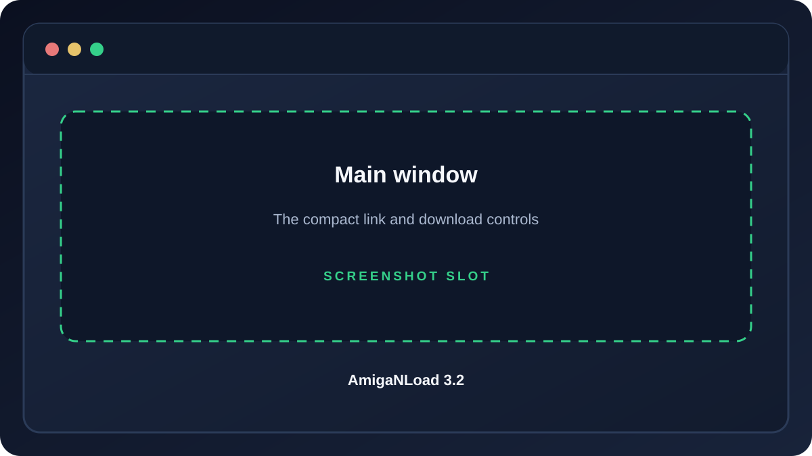
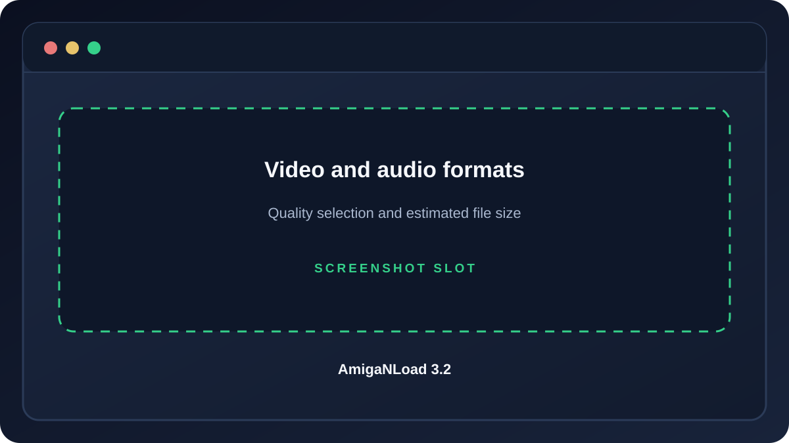
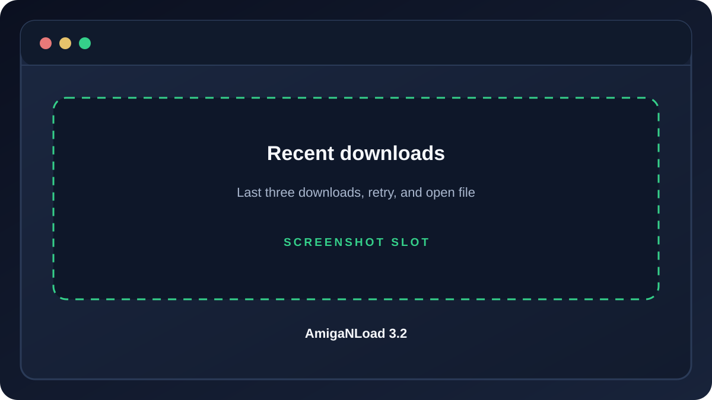

  

# AmigaNLoad
### دانلودر سبک و جمع‌وجور ویدئو و صدا برای ویندوز

لینک را وارد کنید، نوع فایل و کیفیت را انتخاب کنید و دانلود را در پوشه دلخواه خود ذخیره کنید.

**AmigaNLoad نام جدید برنامه Downloading است.** برای حفظ سازگاری نسخه‌های قبلی، آدرس مخزن GitHub و پوشه دانلود و تاریخچه قدیمی حفظ شده‌اند.

## یک دانلودر ساده، بدون محیط شلوغ

AmigaNLoad یک برنامه دسکتاپ ویندوز برای دریافت ویدئو و فایل صوتی از وب‌سایت‌های پشتیبانی‌شده است. برنامه با استفاده از yt-dlp لینک را بررسی می‌کند، اطلاعات رسانه و حجم تقریبی را نمایش می‌دهد و فایل انتخاب‌شده را روی کامپیوتر شما ذخیره می‌کند.

برای استفاده از خود برنامه به حساب کاربری، اشتراک یا فضای ابری نیازی ندارید. برای دریافت فایل از اینترنت، اتصال اینترنت لازم است.

## امکانات برنامه

- **وارد کردن لینک:** لینک را مستقیماً وارد کنید یا با دکمه Paste از کلیپ‌بورد قرار دهید.
- **بررسی خودکار لینک:** در صورت ارائه اطلاعات توسط سایت، عنوان رسانه و حجم تقریبی دانلود نمایش داده می‌شود.
- **انتخاب کیفیت ویدئو:** کیفیت‌های Best، 1080p، 720p و 480p.
- **دریافت فایل صوتی:** انتخاب MP3 با کیفیت 320 کیلوبیت یا بهترین کیفیت صوتی اصلی.
- **انتخاب محل ذخیره:** استفاده از پوشه پیش‌فرض یا انتخاب هر پوشه دلخواه.
- **نمایش روند دانلود:** درصد پیشرفت، سرعت انتقال و وضعیت موفقیت یا خطا.
- **تاریخچه دانلودها:** نگهداری سه دانلود اخیر، تلاش مجدد برای دانلود ناموفق و باز کردن فایل دریافت‌شده.
- **استفاده از نشست مرورگر:** برای محتوایی که نیاز به ورود دارد، امکان انتخاب پروفایل مرورگرهای شناسایی‌شده مانند Firefox، Edge، Chrome، Brave، Vivaldi، Chromium، Opera و Opera GX وجود دارد.
- **پنجره کوچک و کاربردی:** کنترل‌های اصلی در یک محیط جمع‌وجور قرار گرفته‌اند.

## تصاویر برنامه

سه محل زیر برای اسکرین‌شات‌های واقعی برنامه آماده شده‌اند. پس از دریافت تصاویر، نمونه‌های فعلی با اسکرین‌شات‌های اصلی جایگزین می‌شوند.

  
  
  

## دانلود آخرین نسخه برای ویندوز

در صفحه آخرین انتشار، فقط دو فایل اصلی برای دانلود قرار می‌گیرند:

| نسخه | مناسب برای | دانلود |
|---|---|---|
| **Setup.exe** | نصب معمولی برای کاربر فعلی ویندوز، همراه با میانبر دسکتاپ، منوی Start و حذف نصب | [دانلود AmigaNLoad Setup](https://github.com/amirhoseinteras/downloading-desktop/releases/latest/download/AmigaNLoad-Setup.exe) |
| **Portable.zip** | اجرای برنامه بدون نصب؛ فایل ZIP را استخراج و AmigaNLoad.exe را اجرا کنید | [دانلود AmigaNLoad Portable](https://github.com/amirhoseinteras/downloading-desktop/releases/latest/download/AmigaNLoad-Portable.zip) |

نسخه Portable فقط فایل اجرایی برنامه و دو تصویر موردنیاز آن را دارد؛ فایل‌های سورس، پوشه‌های ساخت، گزارش تست و ابزارهای غیرضروری داخل آن قرار نمی‌گیرند.

## ارتقا از Downloading 3.1

نسخه 3.2 برای حفظ سازگاری، از پوشه نصب و کلید حذف نصب نسخه قبلی استفاده می‌کند. نصب نسخه جدید، فایل اجرایی قدیمی را جایگزین می‌کند و نام میانبرهای دسکتاپ و منوی Start به AmigaNLoad تغییر می‌کند.

پوشه دانلود و تاریخچه قبلی برای حفظ فایل‌ها و سوابق، در همان مسیر باقی می‌مانند:

~~~text
%USERPROFILE%\Downloads\Downloading
~~~

پیش از نصب، برنامه قدیمی Downloading را ببندید. نصب یا حذف برنامه، فایل‌های دانلودشده شما را پاک نمی‌کند.

## پیش‌نیازها و محدودیت‌ها

- Windows 10 یا Windows 11.
- فایل‌های Setup و Portable منتشرشده برای اجرا به نصب جداگانه Python نیاز ندارند.
- پشتیبانی از وب‌سایت‌ها و کیفیت‌های قابل دریافت به yt-dlp و تغییرات وب‌سایت‌ها بستگی دارد.
- برخی وب‌سایت‌ها نیازمند ورود معتبر هستند؛ در این حالت می‌توانید از نشست مرورگرهای پشتیبانی‌شده استفاده کنید.
- FFmpeg به‌صورت پیش‌فرض همراه برنامه نیست. ادغام بعضی فرمت‌ها و تبدیل صدا به MP3 به نصب جداگانه FFmpeg نیاز دارد.
- فقط محتوایی را دانلود کنید که مجوز قانونی دریافت آن را دارید.

## اجرای سورس و ساخت برنامه

برای توسعه، Python نسخه 3.10 یا جدیدتر به همراه Tkinter لازم است.

~~~powershell
python -m pip install -r requirements.txt
python -m pip install pyinstaller
python downloading.py
python -m unittest discover -s tests -v
python build_windows.py
~~~

فایل‌های Setup و Portable در پوشه dist ساخته می‌شوند.

## حریم خصوصی و امنیت

تاریخچه دانلودها به‌صورت محلی ذخیره می‌شود و به سرویس ابری ارسال نمی‌شود. مسیر قدیمی تاریخچه حفظ شده تا اطلاعات نسخه Downloading از دست نرود.

فایل‌های اجرایی ویندوز امضای دیجیتال ندارند و ممکن است Windows SmartScreen هشدار نمایش دهد. پیش از اجرا، سورس و اطلاعات انتشار را بررسی کنید و برای عبور از هشدار، محافظت امنیتی ویندوز را خاموش نکنید.

## اطلاعات پروژه

- مجوز: [GPL-3.0-or-later](LICENSE)
- اجزای شخص ثالث: [THIRD_PARTY.md](THIRD_PARTY.md)
- راهنمای امنیت: [SECURITY.md](SECURITY.md)
- تاریخچه نسخه‌ها: [CHANGELOG.md](CHANGELOG.md)
- گزارش مشکل و پیشنهاد: [GitHub Issues](https://github.com/amirhoseinteras/downloading-desktop/issues)
- مخزن رسمی: [amirhoseinteras/downloading-desktop](https://github.com/amirhoseinteras/downloading-desktop)

