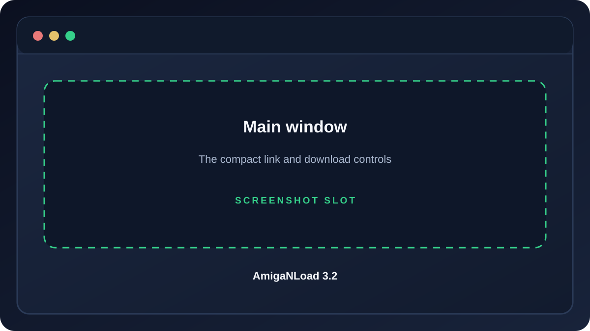
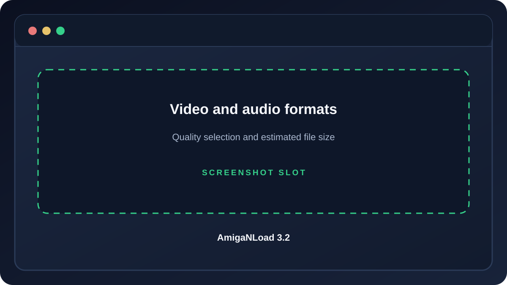
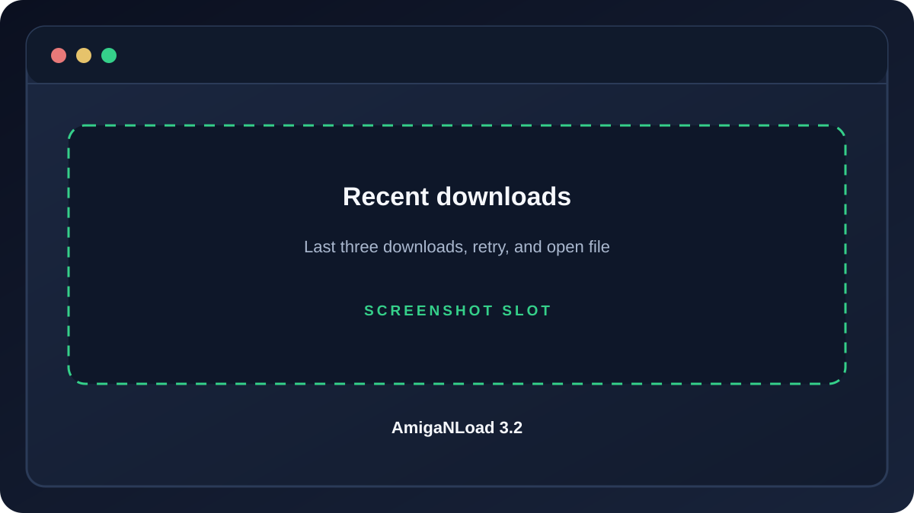

  

<h1 align="center">AmigaNLoad</h1>

<strong>A compact Windows video and audio downloader.</strong>

Paste a link. Choose a format. Set the quality. Download and keep it organized.

  <a href="https://github.com/amirhoseinteras/downloading-desktop/releases/latest/download/AmigaNLoad-Setup.exe"><strong>Download Setup</strong></a>
  ·
  <a href="https://github.com/amirhoseinteras/downloading-desktop/releases/latest/download/AmigaNLoad-Portable.zip"><strong>Download Portable</strong></a>
  ·
  <a href="README.fa.md">راهنمای فارسی</a>

  
  
  

**AmigaNLoad is the new name of Downloading.** The repository address and legacy download-history folder are kept for compatibility with existing users.

## A straightforward downloader, without a complicated interface

AmigaNLoad is a small Windows desktop application for downloading supported online video and audio. It uses yt-dlp to inspect a link, show available media information, and download the selected format to a folder on your computer.

No account, subscription, or cloud library is required. The application runs on your Windows PC; an internet connection is needed to access the media source.

## What you can do

- **Paste or enter a link:** paste a URL from the clipboard or type it directly.
- **Preview media details:** automatically check the link and estimate the download size when source metadata is available.
- **Choose video quality:** Best, 1080p, 720p, or 480p.
- **Download audio:** choose MP3 320 kbps or the best available original audio.
- **Select where to save:** use the default folder or choose another location.
- **Follow the progress:** see download percentage, transfer speed, and completion or error status.
- **Keep a short history:** the app remembers the three most recent downloads, lets you retry a failed item, and opens a downloaded file when available.
- **Use supported browser sessions:** for content that requires login, choose a detected Firefox, Edge, Chrome, Brave, Vivaldi, Chromium, Opera, or Opera GX profile.
- **Stay compact:** a small, focused window keeps the main download controls together.

## Screenshots

The three image areas are reserved for real application screenshots. Replace these placeholders when the screenshots are supplied.

  
  
  

## Download for Windows

The latest release is designed to present only two downloads:

| Package | Choose this when | Download |
| --- | --- | --- |
| **Setup (.exe)** | You want a normal per-user installation with Desktop and Start Menu shortcuts and an uninstaller. | [AmigaNLoad Setup](https://github.com/amirhoseinteras/downloading-desktop/releases/latest/download/AmigaNLoad-Setup.exe) |
| **Portable (.zip)** | You want to extract the archive and run AmigaNLoad.exe without installing it. | [AmigaNLoad Portable](https://github.com/amirhoseinteras/downloading-desktop/releases/latest/download/AmigaNLoad-Portable.zip) |

The Portable archive contains only the application executable and its two required image assets. It does not include source code, build folders, test logs, or unrelated utilities.

### Updating from Downloading 3.1

AmigaNLoad 3.2 keeps the former Downloading installation folder and uninstall registry entry so the new Setup can replace the old executable in place. The Start Menu and Desktop shortcuts are renamed to AmigaNLoad. The existing download folder and recent-download history remain under:

~~~text
%USERPROFILE%\Downloads\Downloading
~~~

Close the old Downloading application before running Setup. Your downloaded media files are not deleted by installation or uninstallation.

## Requirements and compatibility

- Windows 10 or Windows 11.
- The published Setup and Portable packages are self-contained Windows executables; Python is not required to run them.
- Supported sites and available formats depend on yt-dlp and may change over time.
- Some sites require a valid login session. Browser-cookie access is available for detected local browser profiles.
- FFmpeg is optional and is not bundled. Some format merging and MP3 conversion operations require a separately installed FFmpeg.
- Use the application only for content you are legally permitted to download.

## Run from source

For development, use Python 3.10 or newer with Tkinter.

~~~powershell
python -m pip install -r requirements.txt
python -m pip install pyinstaller
python downloading.py
python -m unittest discover -s tests -v
python build_windows.py
~~~

The build script creates the Setup and Portable packages in the dist folder.

## Privacy and security

AmigaNLoad does not upload your saved download history to a cloud service. The recent-download list is stored locally in the legacy Downloading folder so existing history remains available.

The published Windows executables are not code-signed. Windows SmartScreen may display a warning. Review the source and release information before running downloaded files; do not disable Windows security protections to bypass a warning.

## Project information

- License: [GPL-3.0-or-later](LICENSE)
- Third-party components: [THIRD_PARTY.md](THIRD_PARTY.md)
- Security guidance: [SECURITY.md](SECURITY.md)
- Changelog: [CHANGELOG.md](CHANGELOG.md)
- Issues and feedback: [GitHub Issues](https://github.com/amirhoseinteras/downloading-desktop/issues)
- Source repository: [amirhoseinteras/downloading-desktop](https://github.com/amirhoseinteras/downloading-desktop)
